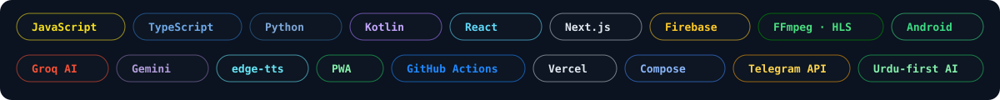
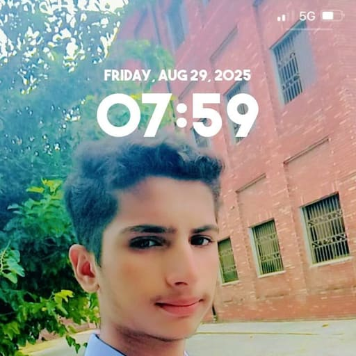
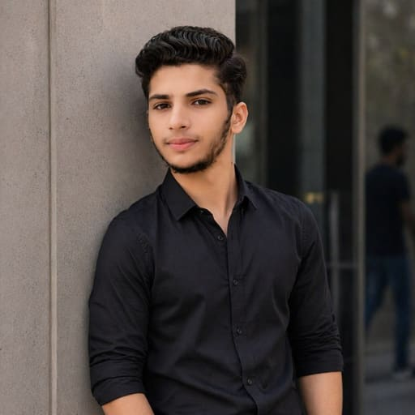

  

<h1 align="center">Assalamu Alaikum, I'm Muaaz Iqbal 👋</h1>

<i>— 𝕸𝖚𝖆𝖆𝖟 𝕴𝖖𝖇𝖆𝖑 · 𝐊𝐚𝐬𝐮𝐫, 𝐏𝐮𝐧𝐣𝐚𝐛, 𝐏𝐚𝐤𝐢𝐬𝐭𝐚𝐧 —</i>

I'm a **17-year-old full-stack & Android developer, AI orchestrator and founder** from **Kasur, Punjab, Pakistan 🇵🇰** — the kind of small city people call a limitation. I call it a **starting point**. I build complete products alone: the database, the checkout, the Android app, the AI assistant, the docs and the deploy pipeline. Then I test them on a cheap phone over a slow connection — because that is the phone and the connection most of my users actually have.

> 💭 **“Unchi soch. Chhote qadam.”** — *high thinking, small steps.*

## 🪪 Quick Facts — janam se le kar aaj tak

| | |
|---|---|
| 🎂 **Date of Birth** | **27 November 2009** — Kasur, Punjab, Pakistan |
| 🎓 **Education** | ICS (Intermediate Computer Science) — Islamia Graduate College, Kasur |
| 📍 **Base** | Kasur, Punjab, Pakistan · PKT (UTC+5) |
| 🧠 **Focus** | Urdu-first products, AI agents, live-streaming pipelines, trading education |
| ⚖️ **Founder of** | **Mizanora** · **Muslim Islam Org** · **M1 Traders** |
| 💼 **Status** | Open to freelance work, collaborations & internships |
| 🌐 **Websites** | [mizanoraorg.web.app](https://mizanoraorg.web.app) · [mizanora.vercel.app](https://mizanora.vercel.app) · [barakatwave.vercel.app](https://barakatwave.vercel.app) |
| 📧 **Email** | muaaziqbal.vip@gmail.com · mezanora.market@gmail.com |
| 💬 **WhatsApp** | [+92 306 2015326](https://wa.me/923062015326) |
| 🛡️ **Principles** | Halal earning · real features only, nothing faked · privacy by default |

## 📊 Live GitHub Stats

  
  

  

  

> 🌱 **Note:** ye GitHub account **naya hai (22 Nov 2026)** — purana account `@muaaziqbalvip` suspend ho gaya (90 repos, 2–3 saal ki mehnat). Saara record ab [mizanoraorg.web.app](https://mizanoraorg.web.app) par mehfooz hai. Stats yahan live grow hongi. 📈

## 🔢 By the Numbers (career — 30 Oct 2026 tak)

| 90+ | 13.7 MB | 800+ | 11,000+ | 38 | 2–3 saal |
|:---:|:---:|:---:|:---:|:---:|:---:|
| Public Repositories | Code Written | Live TV Channels | Store Products | Free Tools | Continuous Mehnat |

## 🚀 Flagship Projects

| Project | Kya hai | Stack | 🗓 |
|---|---|---|---|
| ⚖️ **[Mizanora](https://mizanora.vercel.app)** | Halal online market for Pakistan — 11,000+ products, Noor AI assistant, checkout + Android app | Next.js 15 · React · Tailwind · Firebase | 2025 → ab |
| 🐍 **Asaan Lang** | Pakistan ki apni programming language — soch Urdu mein, code Roman-Urdu mein | Python 3.8+ · TypeScript · MIT | 2026 |
| 📺 **[BarakatWave TV](https://barakatwave.vercel.app)** | 800 channels live TV + IMDb cinema + free Xtream server — Televizo-proof | hls.js · FFmpeg · IMDb API · Vercel | 2025 → 2026-10 |
| 🎛 **SIRAVEX** | Premium web IPTV & universal media player — *real features only, nothing faked* | TypeScript · React · PWA · hls.js | 2026 |
| 📈 **MI Trade Master** | Trading seekho — AI chart reading + paper trading, koi real paisa nahi | Kotlin · Jetpack Compose · Firebase · Groq | 2026 |
| 🤖 **MI Trade Master Bot** | 24/7 free signal bot — bina kisi server ke | Python · Telegram API · GitHub Actions · Vision AI | 2026 |

<b>📦 Poora project index — 17 documented builds (click to expand)</b>

| # | Project | Category | Stack | 🗓 |
|---|---|---|---|---|
| 1 | Mizanora — halal market + Noor AI | Commerce | Next.js 15 · React · Tailwind · Firebase | 2025 → 2026-11 |
| 2 | Asaan Lang — Urdu programming language | Language | Python 3.8+ · TypeScript | 2026 |
| 3 | BarakatWave TV — 800 channels + IMDb cinema | Streaming | hls.js · FFmpeg · IMDb API · Vercel | 2025 → 2026-10 |
| 4 | Mizanora WhatsApp AI — multi-provider agent | AI | Python · Groq · Gemini · edge-tts | 2026 |
| 5 | StreamForge 24/7 — self-healing broadcast | Streaming | FFmpeg · GitHub Actions · Node.js | 2026 |
| 6 | MIZANORA TV LIVE — 24/7 TV on GH Actions + Pages | Streaming | GitHub Actions · GitHub Pages · FFmpeg | 2026 → 2026-11 |
| 7 | Mizanora Android — cloud phone (always-on emulator) | Android | Shell · GH Actions · ws-scrcpy · cloudflared | 2026 |
| 8 | SIRAVEX — premium web IPTV player | Streaming | TypeScript · React · PWA · hls.js | 2026 |
| 9 | MI Trade Master — AI trading teacher | Trading | Kotlin · Jetpack Compose · Firebase · Groq | 2026 |
| 10 | MI Trade Master Bot — 24/7 signal bot | Trading | Python · Telegram API · Vision AI | 2026 |
| 11 | IPTV Reseller Suite v6.1.2 — owner → reseller → client | Streaming | Node.js · Firebase · Vercel · Xtream Codes | 2026 → 2026-11 |
| 12 | Muslim Islam Org — community portal | Community | React · Firebase | 2025 → 2026 |
| 13 | Islamic Calendar app — Mizanora family | Islamic | Web · Firebase | 2026 |
| 14 | Noor AI — Urdu-first assistant (messy sentence samajhta hai) | AI | Groq · Gemini · Next.js | 2025 → 2026 |
| 15 | TMDB streaming front end — guest mode, no login | Streaming | JavaScript · TMDB · Vercel | 2026 |
| 16 | Android IPTV player — 4 themes, gestures, auto-retry | Android | Kotlin · Jetpack Compose · Media3/ExoPlayer | 2026 |
| 17 | Animated parcel journey — honest estimated vs real data | Commerce | Serverless · PWA · SEO | 2026 |

➡️ Sab projects ki poori kahani, dates aur incident detail: [mizanoraorg.web.app/projects.html](https://mizanoraorg.web.app/projects.html)

## 🆕 Is GitHub par (Nov 2026)

| Repo | Kya hai |
|---|---|
|  [**muaaz-iqbal/MIZANORAORG**](https://github.com/muaaz-iqbal/MIZANORAORG) | **Mizanora Platform** — Muaaz Iqbal ka official digital record: status feed, 17 projects, blogs, team, media gallery, timeline aur GitHub-suspension incident ki imaandar detail. Zero-build static site + Firebase (Auth · Firestore · Storage), dual hosting: GitHub Pages + Firebase Hosting → [mizanoraorg.web.app](https://mizanoraorg.web.app) |
| 👤 [**muaaz-iqbal/muaaz-iqbal**](https://github.com/muaaz-iqbal/muaaz-iqbal) | Ye profile README — 3D animated hero, live stats, timeline aur gallery |

## 🕰️ Timeline — janam se aaj tak

| Date | Event |
|---|---|
| **2009-11-27** | 🎂 Janam — Kasur, Punjab, Pakistan |
| **2023–2024** | 🌱 Shuruaat — pehle projects: web experiments, streaming pipelines, Android apps · Islamia Graduate College me ICS |
| **2025** | ⚖️ Mizanora ka qayam — store (11,000+ products), Noor AI, Muslim Islam Org, BarakatWave TV v1 |
| **2026** | 🚀 Flagship year — Asaan Lang v1.1, SIRAVEX, MI Trade Master + Bot, WhatsApp AI, StreamForge, cloud Android, IPTV Reseller Suite · 90 public repos · 13.7 MB code |
| **2026-10-30** | 📊 Career stats verified — 90 repos · 800 live channels · 11,000+ products · 38 free tools |
| **2026-11 (mid)** | ⚠️ GitHub suspension — `@muaaziqbalvip` 404; 90 repos gayab. Mizanora-org → Mizanoraorg rename se 4 repos mehfooz |
| **2026-11-02** | 🧾 v47 + IPTV Reseller Suite v6.1.2 — billing, cron auto-suspend, audit log |
| **2026-11-16** | 📦 Aakhri org push — MIZANORA repo (v59.2 restore ke baad) |
| **2026-11-22** | 🆕 Naya GitHub account `muaaz-iqbal` — dobara shuruaat |
| **2026-11-23** | 🌐 Mizanora Platform launch — [mizanoraorg.web.app](https://mizanoraorg.web.app) · saara record ek jagah |

## 🧰 Skills & Stack

  
  
  
  
  
  
  
  
  
  
  
  
  
  
  
  
  
  
  
  

## 📈 M1 Traders — Trade | Analyze | Succeed

  

> **Focus · Discipline · Patience · Success** — *علم سے نظم تک، نظم سے کامیابی تک*
> Accurate signals · Expert analysis · Risk management · Consistent profits — aur **MI Trade Master** me paper-trading: seekho bina real paisa lagaye.

## 🖼️ Gallery — Kasur se duniya tak

<table align="center">
  <tr>
    <td align="center"> 𝓕𝓸𝓻𝓶𝓪𝓵 𝓵𝓸𝓸𝓴 👔</td>
    <td align="center"> 𝓒𝓸𝓵𝓵𝓮𝓰𝓮 𝓭𝓪𝔂𝓼 🎓</td>
    <td align="center"> 𝓐𝓵𝓵 𝓫𝓵𝓪𝓬𝓴 🖤</td>
  </tr>
  <tr>
    <td align="center"> 𝓢𝓱𝓪𝓭𝓮𝓼 𝓸𝓷 😎</td>
    <td align="center"> 𝓒𝓪𝓼𝓾𝓪𝓵 𝓰𝓻𝓮𝔂 ☁️</td>
    <td align="center"> 𝓜𝓲𝓷𝓪𝓻-𝓮-𝓟𝓪𝓴𝓲𝓼𝓽𝓪𝓷 🕌</td>
  </tr>
</table>

## 🤝 Let's Build Something

Main **freelance work, collaborations aur internships** ke liye open hoon — khaas tor par wo kaam jo software logon ki apni zaban me pohanchaye: **Urdu-first products, education tools, Android apps, AI agents aur streaming infrastructure**.

  
  
  
  

💚 _Agar yahan ki koi cheez kaam aayi, to repo par ek ⭐ hi poori payment hai._

---

  
    
  <b>Muaaz Iqbal</b> · Kasur, Punjab, Pakistan 🇵🇰 
  <i>“Unchi soch. Chhote qadam.”</i>  
  Built by hand, tested on a cheap phone 📱 · Last updated 23 Nov 2026

