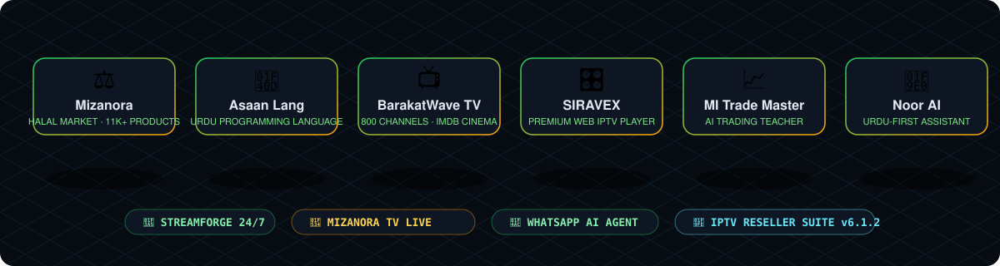

<p align="center">
  
</p>

<p align="center">
  
  
  
  
</p>

# ⚖️ MIZANORAORG — Mizanora Platform

**Mizanora** (*Mizan* = balance, *Noor* = illumination) — **Muaaz Iqbal** ka pura digital record, ek hi website par. Yeh koi demo nahi hai: **2–3 saal ka kaam, 17 projects**, aur unke sath juda har waqia — kya bana, kis date push hua, kya stack laga, aur kya hadsa pesh aaya.

> **“Unchi soch. Chhote qadam.”** — Muaaz Iqbal · Kasur, Punjab, Pakistan 🇵

| | |
|---|---|
| 🌐 **Live** | [mizanoraorg.web.app](https://mizanoraorg.web.app) (GitHub Pages + Firebase Hosting, dual) |
| 👨‍💻 **Founder** | Muaaz Iqbal — born **27 Nov 2009**, Kasur, Punjab · ICS, Islamia Graduate College |
| 🧱 **Stack** | Plain HTML + CSS + ES-modules JavaScript · Firebase (Auth · Firestore · Storage) · zero-build |
| 📄 **Pages** | index · projects · blog · about · team · admin |
| 🤖 **Workflows** | deploy-pages · deploy-firebase · seo (auto-sitemap + Google-ready SEO) |
| 📜 **License** | MIT |


## 🧊 Ecosystem — 3D floor par sab projects




## 📡 Status Feed — live updates

| Date | Type | Update |
|---|---|---|
| **23 Nov 2026** | 🌐 release | Mizanora Platform launch — saara record ek jagah |
| **22 Nov 2026** | 🚀 release | Platform v2 — official gold mark, 10 blogs with generated covers, auto-sitemap, dual hosting |
| **22 Nov 2026** | ⚠️ incident | GitHub account `@muaaziqbalvip` suspend — 90 repos (2–3 saal ki mehnat) 404. Recovery + backup drive jaari |
| **15 Nov 2026** | 🛠 build | MIZANORA main project par naya push (v59.2 restore ke baad stabilization) |
| **12 Nov 2026** | 🛠 build | MIZANORAAI update — AI features ka agla iteration |
| **7 Nov 2026** | 🔙 release | v60 speed release rollback — shop wapas stable v59.2 par. *Stability pehle, speed baad me.* |
| **5 Nov 2026** | 🚀 release | v55 — offline IMDb snapshot, universal search, singer pages, calendar, theater-grade player |
| **1 Nov 2026** | 🚀 release | v47 — billing + cron auto-suspend, blacklist/whitelist, lockout, audit log, bulk lines · IPTV Reseller Suite v6.1.2 |

## 🔢 By the Numbers (30 Oct 2026 tak)

| 90+ | 13.7 MB | 800+ | 11,000+ | 38 | 2–3 saal |
|:---:|:---:|:---:|:---:|:---:|:---:|
| Public Repositories | Code Written | Live TV Channels | Store Products | Free Tools | Continuous Mehnat |

<p align="center"></p>

## 🚀 Flagship Projects

| Project | Kya hai | Stack | 🗓 |
|---|---|---|---|
| ⚖️ **Mizanora** | Halal online market for Pakistan — 11,000+ products, Noor AI assistant | Next.js 15 · React · Tailwind · Firebase | 2025 → 2026-11 |
| 🐍 **Asaan Lang** | Pakistan ki apni programming language — soch Urdu mein, code Roman-Urdu mein | Python 3.8+ · TypeScript · MIT | 2026 |
| 📺 **BarakatWave TV** | 800 channels live TV + IMDb cinema + free Xtream server — Televizo-proof | hls.js · FFmpeg · IMDb API · Vercel | 2025 → 2026-10 |
| 🎛️ **SIRAVEX** | Premium web IPTV & universal media player — *real features only, nothing faked* | TypeScript · React · PWA · hls.js | 2026 |
| 📈 **MI Trade Master** | Trading seekho — AI chart reading + paper trading, koi real paisa nahi | Kotlin · Jetpack Compose · Firebase · Groq | 2026 |
| 🤖 **MI Trade Master Bot** | 24/7 free signal bot — bina kisi server ke | Python · Telegram API · GitHub Actions · Vision AI | 2026 |

<details>
<summary><b>📦 Poora index — 17 documented builds (click to expand)</b></summary>

| # | Project | Category | Stack |
|---|---|---|---|
| 1 | Mizanora — halal market + Noor AI | Commerce | Next.js 15 · React · Tailwind · Firebase |
| 2 | Asaan Lang — Urdu programming language | Language | Python 3.8+ · TypeScript |
| 3 | BarakatWave TV — 800 channels + IMDb cinema | Streaming | hls.js · FFmpeg · IMDb API · Vercel |
| 4 | Mizanora WhatsApp AI — multi-provider agent | AI | Python · Groq · Gemini · edge-tts |
| 5 | StreamForge 24/7 — self-healing broadcast | Streaming | FFmpeg · GitHub Actions · Node.js |
| 6 | MIZANORA TV LIVE — 24/7 TV on GH Actions + Pages | Streaming | GitHub Actions · GitHub Pages · FFmpeg |
| 7 | Mizanora Android — cloud phone (always-on emulator) | Android | Shell · GH Actions · ws-scrcpy · cloudflared |
| 8 | SIRAVEX — premium web IPTV player | Streaming | TypeScript · React · PWA · hls.js |
| 9 | MI Trade Master — AI trading teacher | Trading | Kotlin · Jetpack Compose · Firebase · Groq |
| 10 | MI Trade Master Bot — 24/7 signal bot | Trading | Python · Telegram API · Vision AI |
| 11 | IPTV Reseller Suite v6.1.2 | Streaming | Node.js · Firebase · Vercel · Xtream Codes |
| 12 | Muslim Islam Org — community portal | Community | React · Firebase |
| 13 | Islamic Calendar app | Islamic | Web · Firebase |
| 14 | Noor AI — Urdu-first assistant | AI | Groq · Gemini · Next.js |
| 15 | TMDB streaming front end — guest mode | Streaming | JavaScript · TMDB · Vercel |
| 16 | Android IPTV player — 4 themes, gestures | Android | Kotlin · Jetpack Compose · Media3/ExoPlayer |
| 17 | Animated parcel journey — honest data | Commerce | Serverless · PWA · SEO |

➡️ Har project ki poori kahani, dates aur incident detail: [mizanoraorg.web.app/projects.html](https://mizanoraorg.web.app/projects.html)
</details>

## 🕰️ Timeline — janam se aaj tak

| Date | Event |
|---|---|
| **2009-11-27** | 🎂 Janam — Kasur, Punjab, Pakistan |
| **2023–2024** | 🌱 Shuruaat — pehle projects · Islamia Graduate College me ICS |
| **2025** | ⚖️ Mizanora ka qayam — store, Noor AI, Muslim Islam Org, BarakatWave TV v1 |
| **2026** | 🚀 Flagship year — Asaan Lang, SIRAVEX, MI Trade Master + Bot, WhatsApp AI, StreamForge · 90 repos · 13.7 MB |
| **2026-11 (mid)** | ⚠️ GitHub suspension — `@muaaziqbalvip` 404; 90 repos gayab |
| **2026-11-22** | 🆕 Naya account `muaaz-iqbal` — dobara shuruaat |
| **2026-11-23** | 🌐 **Ye Platform** — Mizanora Platform launch: status, blogs, projects, team, media, timeline |

## 🧱 Repo Structure & Workflows

```
MIZANORAORG/
├── index.html  projects.html  blog.html  about.html  team.html  admin.html
├── assets/
│   ├── css/ (style.css · enhance.css)   ├── js/ (data.js · main.js · admin.js · store.js · enhance.js)
│   ├── img/ (gold mark · blog covers · og-cover)  └── readme/ (3D hero · ecosystem · ticker · bars)
├── .github/workflows/
│   ├── deploy-pages.yml     → GitHub Pages par auto-deploy
│   ├── deploy-firebase.yml  → Firebase Hosting par auto-deploy
│   └── seo.yml              → auto-sitemap + SEO generate
├── firebase.json · firestore.rules · .firebaserc
├── scripts/generate-seo.mjs
└── sitemap.xml · robots.txt · rss.xml · llms.txt
```

**Locally chalane ke liye:**
```bash
git clone https://github.com/muaaz-iqbal/MIZANORAORG.git
cd MIZANORAORG
python3 -m http.server 8000     # ya bas index.html browser me kholein — zero build!
```

## 👨‍💻 Founder

<table align="center">
  <tr>
    <td align="center"><br><sub><b>Muaaz Iqbal</b> · Founder & Lead Developer</sub></td>
    <td align="center"><br><sub><b>M1 Traders</b> · Trade | Analyze | Succeed</sub></td>
  </tr>
</table>

> 🛡️ **Principles:** halal earning · *real features only, nothing faked* · privacy by default · har feature saste phone par test hota hai — *“built by hand, tested on a cheap phone.”*

<p>
  <a href="https://wa.me/923062015326"></a>
  <a href="mailto:mezanora.market@gmail.com"></a>
  <a href="https://mizanoraorg.web.app"></a>
  <a href="https://github.com/muaaz-iqbal"></a>
</p>


---

<p align="center">
  
  <br><br>
  <b>⚖️ MIZANORA</b> · <i>Mizan = balance · Noor = illumination</i><br>
  <sub>© 2026 Mizanora · Built by hand by <b>Muaaz Iqbal</b> · Kasur, Punjab, Pakistan 🇵🇰 · MIT License</sub><br>
  <sub>“Jo account par hai, wo gayab ho sakta hai. Jo aapki site par hai, wo mehfooz hai.”</sub>
</p>
